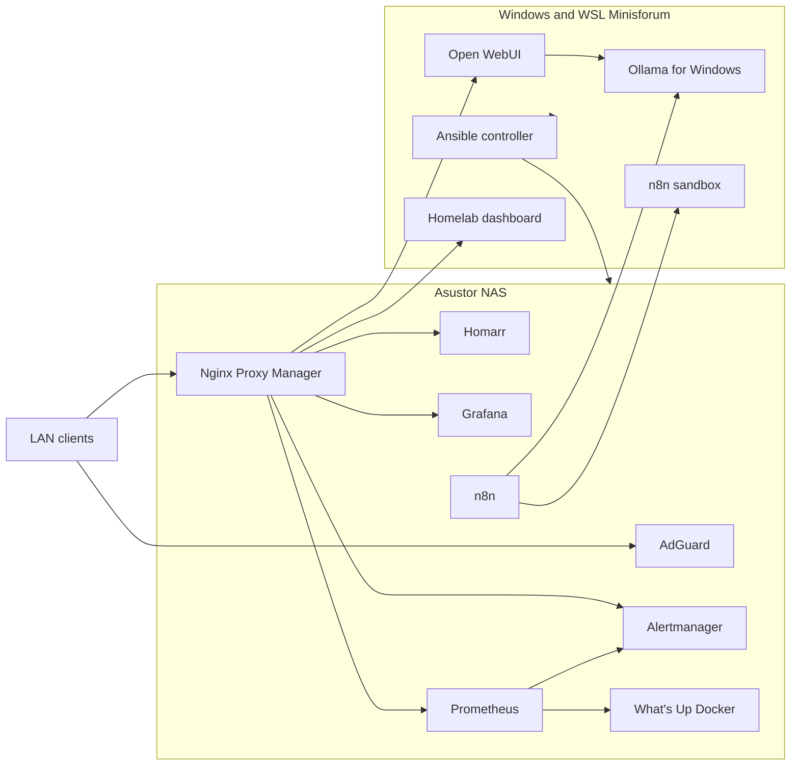

# Homelab Ansible

[Français](README.md) · [English](README.en.md)

Deployment and operation of a homelab distributed across two machines:

- an Asustor NAS for always-on services;
- a Windows/WSL Minisforum for local workloads and AI;
- Ansible as the source of truth for configuration and deployments.

This repository is safe to publish: installation-specific addresses, domains, credentials, and tokens are not committed. They are loaded from Ansible Vault and local files ignored by Git.

## Architecture



No inbound port is intentionally opened on the Freebox router. Services are intended for the local network. Outbound Internet access is still required for Docker images, DNS, SMTP, and external APIs.

## Managed services

| Area | Main services |
| --- | --- |
| Portal and proxy | Homarr, Nginx Proxy Manager |
| Monitoring | Prometheus, Grafana, Alertmanager, Node Exporter, cAdvisor |
| Containers | What's Up Docker, controlled update automation |
| Network | AdGuard, Windows DNS, local TLS certificates |
| AI and automation | Ollama, Open WebUI, n8n and its sandbox |
| Home automation | Existing Home Assistant installation, audited without reinstalling it |
| Backups | Configuration archives and release manifests |

AdGuard and Home Assistant are installed through ADM on the NAS. This repository configures or audits them but does not reinstall them. Ollama is an existing Windows service on the Minisforum.

## Repository layout

```text
homelab-ansible/
├── ansible.cfg
├── playbook.yml                    # Full deployment
├── playbook/                       # Specialized operations and checks
├── config/                         # Targeted deployment profiles
├── roles/docker_stack/
│   ├── defaults/                   # Public, non-sensitive defaults
│   ├── vars/services/              # Service definitions
│   ├── tasks/                      # Deployment and post-configuration
│   └── templates/                  # Generated Compose and configuration files
└── scripts/                        # Collection, backup, and local tools
```

The following items remain local and are ignored by Git:

```text
.vault_password
.env
.env.*
inventory.yml
group_vars/
host_vars/
.local-pki/
artifacts/
logs/
```

`.env.example` may be committed only when it contains placeholder values.

## Requirements

- Ubuntu or WSL with Ansible;
- SSH and sudo access to the NAS;
- Docker and Docker Compose on the relevant hosts;
- the `community.docker` and `community.crypto` Ansible collections;
- a local inventory;
- an Ansible Vault file and its local password.

```bash
ansible-galaxy collection install community.docker community.crypto
```

## Private configuration

By default, `ansible.cfg` loads the inventory from `./inventory.yml`, roles from `./roles`, and the Vault password from `./.vault_password`.

Create the password file without committing it:

```bash
printf '%s\n' 'your-vault-password' > .vault_password
chmod 600 .vault_password
```

Create or edit the Vault:

```bash
mkdir -p group_vars/all
ansible-vault create group_vars/all/vault.yml
# Or, if it already exists:
ansible-vault edit group_vars/all/vault.yml
```

Infrastructure variables expected in the Vault:

```yaml
nas_ip: "..."
minisforum_host: "..."
ollama_windows_host: "..."
freebox_ip: "..."
basedomain: "..."
alert_email_to: "..."
```

The Vault also contains the accounts, passwords, and tokens required by NPM, Homarr, SMTP, Home Assistant, Freebox OS, n8n, GitHub, and calendar providers.

Check that parameters are present without displaying their values:

```bash
ansible-playbook playbook/vault-readiness.yml
```

## Quick start

Run every command from the repository root.

```bash
# Check syntax
ansible-playbook playbook.yml --syntax-check

# Deploy services defined in the inventory
ansible-playbook playbook.yml

# Deploy a specific profile
ansible-playbook playbook/operations.yml -e @config/monitoring-nas.yml
ansible-playbook playbook/operations.yml -e @config/monitoring-minisforum.yml
```

Other common profiles:

```bash
ansible-playbook playbook/operations.yml -e @config/alertmanager.yml
ansible-playbook playbook/operations.yml -e @config/grafana.yml
ansible-playbook playbook/operations.yml -e @config/homarr-dashboard.yml
ansible-playbook playbook/operations.yml -e @config/update-automation.yml
```

## Common operations

### Monitoring

```bash
ansible-playbook playbook/verify-monitoring.yml
ansible-playbook playbook/verify-homarr-dashboard.yml
ansible-playbook playbook/quota-collectors.yml
```

### DNS and TLS

Audit before applying changes:

```bash
ansible-playbook playbook/adguard-audit.yml
ansible-playbook playbook/adguard-configure.yml
ansible-playbook playbook/pki.yml
ansible-playbook playbook/proxy.yml
```

Windows DNS is changed only when explicitly requested and from a session with administrator rights:

```bash
ansible-playbook playbook/windows-dns.yml
ansible-playbook playbook/windows-dns.yml -e windows_dns_apply=true
```

### Backups and updates

```bash
ansible-playbook playbook/backup-config.yml
ansible-playbook playbook/verify-update-automation.yml
ansible-playbook playbook/update-alertmanager.yml
ansible-playbook playbook/schedule-container-updates.yml
```

Backups and email tests are not idempotent: they intentionally create an additional archive or event.

### Application audits

```bash
ansible-playbook playbook/audit.yml
ansible-playbook playbook/npm-audit.yml
ansible-playbook playbook/homeassistant-audit.yml
ansible-playbook playbook/homeassistant-auth-check.yml
ansible-playbook playbook/test-alert-email.yml
```

`test-alert-email.yml` sends a real alert and may also produce a resolution message.

## Security

- Never add `.vault_password`, a decrypted Vault, `.env`, a private key, or a backup archive to Git.
- Keep CA keys in `.local-pki/`. Only the public `ca.crt` certificate should be distributed to clients.
- Compose templates that may contain secrets are generated with restrictive permissions.
- Tasks handling credentials use `no_log` where appropriate.
- Mounting the Docker socket, even read-only, provides highly privileged access to the Docker engine.
- Keep the privileged n8n runner restricted to its intended network and use cases.
- The absence of Internet port forwarding does not replace authentication on the LAN.

Before publishing a change:

```bash
for file in playbook/*.yml; do
  ansible-playbook "$file" --syntax-check || exit 1
done

git diff --check
git status --short
```

A secret scanner such as Gitleaks is recommended locally and in CI.

## Deployment behavior

The `docker_stack` role:

1. loads service-specific variables;
2. generates its `.env` and Compose file;
3. applies required configuration;
4. starts or reconciles the stack;
5. checks its state;
6. runs optional post-configuration and proxy tasks.

Images use `pull: missing` by default to prevent implicit upgrades on every run. Sensitive migrations, including Alertmanager, follow an explicit validation, backup, test, and promotion path.

## Known limitations

- The inventory and Vault must be backed up separately from the repository.
- Application archives must be copied away from the NAS.
- WSL exporters are not a replacement for full Windows monitoring.
- The local CA must be trusted on every client using HTTPS.
- Full restores and regular secret rotation must be tested.

## License and contributions

This repository describes a personal infrastructure. Review paths, ports, images, and security assumptions before reusing it in another environment.
