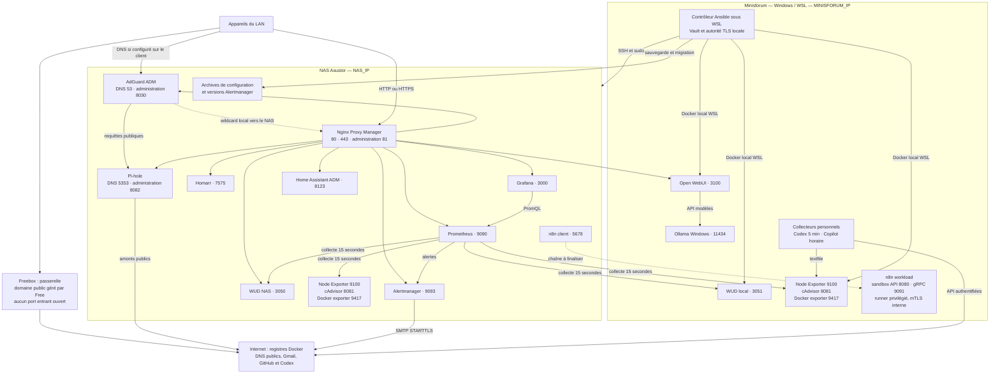
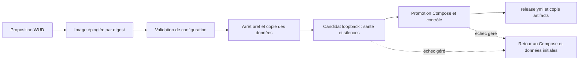

# Homelab Ansible

Infrastructure Docker du NAS Asustor et du Minisforum, pilotée depuis Ubuntu/WSL. Ce document décrit le code et les actions vérifiées au 14 septembre 2026, sans confondre fonctionnalités prévues et terminées.

## 1. Principes

- Aucun port entrant ouvert sur la Freebox. Accès depuis le LAN ; sorties Internet nécessaires pour images, DNS, SMTP et API.
- Ansible génère Compose, configurations, dashboards, certificats et collecteurs. Les post-configurations doivent rester réintégrables.
- AdGuard et Home Assistant sont **déjà installés par ADM** : ce dépôt ne les réinstalle pas.
- Ollama est un **service Windows existant** sur le Minisforum. Le template Docker Ollama historique n'est pas le service utilisé.
- Grafana visualise, Prometheus collecte et évalue les règles, WUD détecte les images disponibles, Alertmanager notifie.
- L'idempotence n'est pas universelle : sauvegardes et tests d'e-mail créent volontairement de nouveaux objets ; le post-déploiement Homarr réapplique un mot de passe.

## 2. Architecture

Les flèches représentent les échanges logiques, pas les règles de pare-feu.



### Nœuds et données

| Nœud | Exécution Ansible | Stockage | Particularités |
| --- | --- | --- | --- |
| `nas`, `NAS_IP` | SSH utilisateur `homelab`, sudo | `/volume1/Docker/<service>` | Applications ADM conservées ; découverte de leurs montages pour les sauvegardes |
| `minisforum`, `MINISFORUM_IP` | Connexion locale Ubuntu/WSL | `/opt/homelab/<service>` | Exporters Linux : métriques WSL, pas toute la machine Windows |
| Windows Minisforum | PowerShell appelé depuis WSL | Installations existantes de Codex/Ollama | Modification DNS soumise aux droits administrateur |

Les hôtes, `docker_profile`, `stacks_base_path` et `services_list` sont définis par `inventory.yml`, `group_vars/` et `host_vars/`. Ces fichiers locaux sont ignorés par Git : un clone seul ne reconstruit pas l'environnement.

### Routes NPM et ports

Ajouter `.PUBLIC_DOMAIN` aux noms suivants. Les dix routes sont gérées par `playbook/proxy.yml`. HTTP reste disponible tant que la confiance dans la CA locale n'est pas déployée sur les appareils.

| Sous-domaine | Destination LAN | Fonction |
| --- | --- | --- |
| `npm` | NAS:81 | Administration NPM |
| `homarr` | NAS:7575 | Portail |
| `grafana` | NAS:3000 | Dashboards |
| `prometheus` | NAS:9090 | Métriques, règles et cibles |
| `alertmanager` | NAS:9093 | Alertes et silences |
| `wud` | NAS:3050 | Images et mises à jour |
| `adguard` | NAS:8030 | DNS ADM |
| `pihole` | NAS:8082 | Filtrage DNS |
| `homeassistant` | NAS:8123 | Domotique ; proxy applicatif à valider |
| `open-webui` | Minisforum:3100 | Interface Ollama |

n8n expose 5678 ; ses routes peuvent être gérées par le rôle global selon ses variables, mais ne font pas partie des dix routes de `proxy.yml`. Les ports 8081, 9100, 9417 et 3051 servent à la collecte. Le candidat Alertmanager écoute uniquement sur `127.0.0.1:19093` du NAS.

## 3. Organisation du dépôt

```text
homelab-ansible/
├── playbook.yml                 # Déploiement global, conservé à la racine
├── playbook/                    # 16 playbooks spécialisés
├── ansible.cfg                  # Inventaire, rôles et chemin du mot de passe Vault
├── inventory.yml                # Local, non versionné
├── group_vars/ et host_vars/    # Variables locales et secrets chiffrés
├── config/                      # Profils de sélection des services et hôtes
├── roles/docker_stack/
│   ├── defaults/                # Valeurs par défaut
│   ├── vars/services/           # Paramètres par service
│   ├── tasks/                   # Compose, santé, proxy et post-configurations
│   └── templates/               # Compose, Prometheus, alertes et dashboards Grafana
├── scripts/                     # Quotas, sauvegarde, audits HA/DNS
├── .local-pki/                  # CA et clés TLS, hors Git
└── artifacts/releases/          # Manifestes récupérés, hors Git
```

Les playbooks spécialisés utilisent `playbook_dir/..` pour les ressources du dépôt. Leur déplacement ne déplace **ni les clés PKI, ni les artefacts, ni les données applicatives**. `ansible.cfg` est versionnable et ne contient aucun secret.

## 4. Catalogue exhaustif des playbooks

| Fichier | Action | Effet / précaution |
| --- | --- | --- |
| `playbook.yml` | Déployer les `services_list` et afficher un récapitulatif | Déploiement global avec post-configurations |
| `playbook/operations.yml` | Déployer `selected_services` sur `target_hosts` | NPM désactivé par défaut ; privilégier les profils `config/` |
| `playbook/audit.yml` | Examiner endpoints ADM, Ollama, Open WebUI et WUD | Diagnostic tolérant aux erreurs, pas un test strict |
| `playbook/verify-monitoring.yml` | Valider Prometheus, au moins huit cibles UP, neuf séries et Alertmanager | Lecture et vérifications strictes |
| `playbook/vault-readiness.yml` | Vérifier la présence des paramètres | Affiche uniquement des booléens |
| `playbook/npm-audit.yml` | Lire routes et identifiants de certificats | Authentification puis lecture |
| `playbook/pki.yml` | Créer/renouveler TLS et importer dans NPM | Conserver impérativement la CA existante |
| `playbook/proxy.yml` | Réconcilier dix sous-domaines et leur certificat | Préserve les réglages non remplacés explicitement |
| `playbook/adguard-audit.yml` | Lire amonts et réécritures DNS | Aucun changement DNS |
| `playbook/adguard-configure.yml` | Tester Pi-hole, sauvegarder et modifier l'amont AdGuard | Modification DNS LAN, aucune installation ADM |
| `playbook/windows-dns.yml` | Auditer les DNS Windows | Applique seulement avec `windows_dns_apply=true` et droits admin |
| `playbook/homeassistant-audit.yml` | Lire les intégrations existantes | Limité aux domaines et titres des intégrations |
| `playbook/homeassistant-auth-check.yml` | Tester le compte HA du Vault | Lire `authentication` et `errors` ; un récapitulatif Ansible sans échec ne prouve pas l'authentification |
| `playbook/quota-collectors.yml` | Déployer scripts, textfile, secret GitHub et cron | Nécessite le client Codex Windows connecté |
| `playbook/test-alert-email.yml` | Injecter une alerte temporaire et vérifier SMTP | Envoie réellement un e-mail, puis éventuellement sa résolution |
| `playbook/backup-config.yml` | Créer une archive de configuration | Non idempotent par nature ; contient des secrets |
| `playbook/update-alertmanager.yml` | Tester et promouvoir la proposition WUD | Arrêt bref ; Alertmanager uniquement |

## 5. Commandes d'exploitation

Lancer depuis `/home/homelab/homelab-ansible` sous WSL, **pas depuis le dossier `playbook/`**. `ansible.cfg` sélectionne `./inventory.yml`, `./roles` et `./.vault_password`. Ansible, Docker Compose et les collections `community.docker` et `community.crypto` doivent être disponibles ; toutes les dépendances ne sont pas encore verrouillées dans le dépôt.

```bash
# Déploiement global : inclut les post-configurations
ansible-playbook playbook.yml

# Déploiements ciblés recommandés
ansible-playbook playbook/operations.yml -e @config/monitoring-nas.yml
ansible-playbook playbook/operations.yml -e @config/monitoring-minisforum.yml
ansible-playbook playbook/operations.yml -e @config/alertmanager.yml

# Quotas et contrôles
ansible-playbook playbook/quota-collectors.yml
ansible-playbook playbook/verify-monitoring.yml
ansible-playbook playbook/vault-readiness.yml

# TLS puis routes
ansible-playbook playbook/pki.yml
ansible-playbook playbook/proxy.yml

# DNS : auditer avant de modifier
ansible-playbook playbook/adguard-audit.yml
ansible-playbook playbook/adguard-configure.yml
ansible-playbook playbook/windows-dns.yml
# Seulement depuis une session Windows administrateur :
ansible-playbook playbook/windows-dns.yml -e windows_dns_apply=true

# Sauvegarde, test d'envoi et migration explicite
ansible-playbook playbook/backup-config.yml
ansible-playbook playbook/test-alert-email.yml
ansible-playbook playbook/update-alertmanager.yml
```

`-i inventory.yml` reste utilisable explicitement. Ajouter `--ask-become-pass` si sudo n'est pas fourni par le Vault. Pour un profil supplémentaire, créer un YAML avec `target_hosts: nas` et, par exemple, `selected_services: [grafana]` : une **liste**, pas une chaîne.

Le profil NAS sélectionne Alertmanager, Prometheus, WUD, Pi-hole et Grafana. Le profil Minisforum sélectionne WUD agent et Open WebUI. Les exporters sont aussi déployables via les listes de l'inventaire ; `quota-collectors.yml` réconcilie Node Exporter sur le Minisforum.

Le rôle charge les variables du service, génère `.env`, exécute sa configuration spécifique, génère Compose, démarre la stack, contrôle son état et exécute la post-configuration/proxy. Compose utilise `pull: missing` par défaut pour éviter les mises à jour implicites à chaque passage. Les templates Compose sont en 0600 et leurs tâches masquées. Les tâches optionnelles utilisent des chemins de rôle corrigés. Prometheus et Alertmanager ne sont rechargés que si leurs configurations changent.

## 6. Supervision, dashboards et quotas

Prometheus collecte toutes les 15 secondes Node Exporter, cAdvisor, Docker exporter et WUD sur les deux nœuds : huit cibles de référence. Le label `server` distingue `nas` et `minisforum`. Le job système `node` est compatible avec 1860. Le mot de passe de collecte WUD est monté séparément dans Prometheus.

| Dashboard | Contenu |
| --- | --- |
| Node Exporter Full 1860, révision 37 | CPU, RAM, systèmes de fichiers, I/O, réseau et autres métriques disponibles ; téléchargement vérifié par SHA-256 |
| Homelab - Santé des serveurs | Synthèse de disponibilité et ressources |
| Homelab - Conteneurs Docker (`homelab-docker-containers`) | Noms lisibles, état, CPU, RAM, débits disque/réseau, image, mises à jour WUD et filtre serveur |
| Homelab - Quotas personnels (`homelab-personal-quotas`) | Fenêtres et réinitialisations Codex, état des collectes et consommation Copilot accessible |

100 % de CPU conteneur correspond à **un cœur** ; la valeur peut dépasser 100 %. Les débits disque ne mesurent pas l'espace occupé par le conteneur : l'espace des systèmes de fichiers figure dans les dashboards serveurs. Les températures dépendent des capteurs exposés. Les exporters WSL ne remplacent pas une supervision complète de Windows.

Codex utilise `account/rateLimits/read` du client Windows connecté, sans publier ses secrets OAuth. Cron exécute la collecte toutes les cinq minutes sous `homelab`, protégée par `flock`. Ce ne sont pas les crédits de l'API OpenAI. Le chemin du client est redécouvert au redéploiement après une éventuelle mise à jour de l'extension Windows.

Copilot utilise le jeton personnel `github_billing_token` avec permission utilisateur `Plan: read`, à la minute 17 de chaque heure. La mesure porte sur l'utilisation du mois civil, pas nécessairement un quota restant. Un échec expose `collection_success=0`, pas une consommation nulle ; les codes HTTP/types d'erreurs non secrets facilitent le diagnostic. WSL et cron doivent rester actifs.

### Alertes

- `ContainerUpdateAvailable` : nouvelle image disponible pendant 15 minutes.
- `MonitoringTargetDown` : cible indisponible pendant 5 minutes.
- `HostDiskAlmostFull` : moins de 10 % libres pendant 10 minutes, hors certains systèmes temporaires.

Alertmanager groupe par `alertname` et `server`, attend 30 secondes, regroupe sur 5 minutes et répète après 24 heures. L'envoi à `ALERT_EMAIL` est **activé** ; les compteurs SMTP ont confirmé des envois sans erreur. La réception en boîte ou dans les spams reste à confirmer par l'utilisateur. L'alerte de test expire après trois minutes et peut générer un e-mail de résolution.

## 7. DNS, TLS, applications et domotique

### DNS et certificats locaux

AdGuard ADM conserve ses réécritures, dont `*.PUBLIC_DOMAIN → NAS_IP`, et transmet les requêtes publiques à Pi-hole sur 5353. Pi-hole utilise `1.1.1.1` et `9.9.9.9`, sans boucle vers AdGuard. Résolution publique et sous-domaine Grafana ont été vérifiés. Tous les clients et listes de filtrage ne sont pas encore audités ; le DNS ne bloque pas toutes les publicités provenant du même domaine que le contenu.

Le domaine public est entièrement géré par Free, sans validation DNS-01 disponible ici. Une CA locale émet un certificat pour le wildcard et le domaine nu. Au lancement de `pki.yml`, le certificat serveur est renouvelé si sa validité restante est inférieure à 30 jours. Aucune planification du renouvellement n'est encore installée.

La clé de CA reste sur le contrôleur. NPM reçoit la clé serveur, son certificat et la CA publique ; un témoin d'empreinte évite les imports inutiles et permet les nouvelles tentatives après échec. Installer **uniquement `.local-pki/ca.crt`** dans les autorités de confiance des clients. La vérification HTTPS Grafana avec cette CA a réussi. Ne jamais distribuer `ca.key`.

### IA et n8n

Open WebUI utilise `http://MINISFORUM_IP:11434`. `ENABLE_PERSISTENT_CONFIG=False` fait prévaloir les variables Ansible sur les anciens réglages persistants. L'API de liste des modèles et les variables effectives ont été vérifiées, pas une conversation complète dans l'interface.

n8n comprend un client NAS et une sandbox Minisforum : génération de certificats mTLS, API et runner Docker privilégié. Le runner a été observé en redémarrage pendant l'audit ; cette chaîne n'est pas déclarée opérationnelle. Aucun workflow n8n/Open WebUI ni ArgoCD ne pilote actuellement les mises à jour de production.

### Home Assistant et Homarr

Le compte HA du Vault a été authentifié avec succès (`create_entry`, aucune erreur). L'audit retrouve des intégrations système et des services DLNA NAS/Freebox ; cela ne signifie pas que le contrôle des appareils est configuré. Freebox, Android TV, PS5, Switch et Minisforum restent à intégrer/appairer. Le proxy HA et ses `trusted_proxies` restent à valider.

Homarr est conservé comme portail et inclus dans les sauvegardes. Son rôle contient un post-déploiement du mot de passe administrateur. L'affichage complet des conteneurs/KPI dans Homarr n'est pas déclaré terminé ; Grafana est la visualisation effectivement provisionnée.

## 8. Sauvegardes et mise à jour contrôlée

Le script de sauvegarde découvre les montages de Homarr (`/appdata`), NPM (`/data`, `/etc/letsencrypt`), AdGuard (`/opt/adguardhome/conf`) et Home Assistant (`/config`). Il crée une archive datée dans `/volume1/Docker/backups/configuration/`, avec un manifeste des images et destinations. Les bases SQLite sont copiées via leur API et contrôlées avec `integrity_check`. Caches, journaux et historique `home-assistant_v2.db` sont exclus. Une archive a été créée avec succès.

Le routage DNS initial est sauvegardé une seule fois dans `/volume1/Docker/backups/adguard/dns-before-pihole.json`. L'archive applicative ne couvre pas tous les volumes : données Prometheus, Pi-hole, n8n et Open WebUI notamment exclues. Copier les archives hors NAS et sauvegarder séparément inventaire, Vault et `.local-pki/`.

Pas encore de rotation, de planification globale ou de restauration automatisée testée. Les UID/GID doivent être vérifiés à la restauration. Restaurer seulement après arrêt de l'application et sauvegarde de son état courant.

### Contrat Alertmanager



La migration Alertmanager v0.28.1 → v0.34.0 a réussi. La version et les données validées sont conservées par les déploiements ordinaires grâce au `release.yml` distant. Le playbook s'arrête sans changement s'il n'y a pas de proposition WUD ou si l'image est déjà en production. `artifacts/releases/nas/alertmanager.yml` contient le manifeste récupéré, **pas les données référencées**.

Le lancement est manuel et limité à Alertmanager. Les autres applications restent en notification seule ; aucun bouton Grafana ne déclenche leur mise à jour. Les données originales sont conservées ; le retour arrière est tenté sur erreur gérée, mais n'a pas été éprouvé par injection de panne. Un arrêt brutal d'Ansible peut nécessiter une reprise manuelle. Ne pas exécuter simultanément déploiement et migration du même service. Chaque application supplémentaire nécessite son propre contrat et ses tests.

## 9. Vault et sécurité

```bash
ansible-vault edit group_vars/all/vault.yml
ansible-playbook playbook/vault-readiness.yml
```

| Variables | Utilisation |
| --- | --- |
| `npm_admin_email`, `homelab_admin_password` | NPM/WUD et configurations associées |
| `ansible_become_password` | Sudo selon l'inventaire |
| `homarr_secret_key` | Chiffrement Homarr |
| `smtp_smarthost`, `smtp_from`, `smtp_username`, `smtp_password` | SMTP avec TLS obligatoire ; Gmail nécessite un mot de passe d'application |
| `alert_email_enabled`, `alert_email_to` | Activation/destinataire, non secrets |
| `homeassistant_username`, `homeassistant_password` | Compte HA existant |
| `github_billing_token` | Lecture personnelle Copilot |
| `adguard_admin_password` | AdGuard, fichier chiffré local sous `group_vars/all/` |
| `sandbox_api_keys`, `sandbox_runner_api_key`, `sandbox_registration_token`, `openai_api_key` | Intégrations n8n/IA selon les services |

Ne publier ni `.vault_password`, ni secrets déchiffrés, ni clés/archives. Des valeurs historiques de démonstration existent dans les defaults : les surcharger, ne pas les utiliser en production. Un socket Docker monté `:ro` **ne rend pas l'API Docker non mutante**. L'accès au socket et le runner privilégié donnent des droits élevés. L'absence de NAT entrant ne remplace pas les contrôles d'accès LAN et l'authentification.

## 10. Bilan et travail restant

| Domaine | Réalisé et vérifié | Limites / suite |
| --- | --- | --- |
| Ansible | Profils ciblés, tâches optionnelles corrigées, pull contrôlé, versions conservées, second passage Minisforum sans changement | Idempotence globale Homarr, dépendances verrouillées, inventaire réintégrable |
| Organisation | 16 playbooks dans `playbook/`, chemins des ressources adaptés, configuration des rôles/inventaire | Mettre à jour les éventuelles commandes personnelles externes au dépôt |
| Monitoring | Huit cibles UP, noms et KPI conteneurs, quatre dashboards | Windows complet, capteurs et espace propre aux conteneurs |
| Quotas | Codex réel collecté, cron actif, token GitHub chargé | API Copilot HTTP 404 : compte, permission et éligibilité à vérifier |
| Notifications | SMTP activé, compteurs d'envoi sans erreur | Réception utilisateur à confirmer |
| NPM/TLS | Dix routes, CA et wildcard importés, HTTPS Grafana vérifié | Confiance CA sur les clients, renouvellement planifié, proxy HA |
| DNS | Pi-hole installé, AdGuard configuré sans réinstallation, résolution validée | DNS Freebox de secours Windows, Tailscale NAS et clients LAN |
| IA | Open WebUI vers Ollama Windows, API modèles accessible | Conversation de bout en bout et runner n8n |
| Domotique/portail | HA authentifié, intégrations auditées, Homarr conservé et sauvegardé | Appairages et KPI Homarr |
| Données/migrations | Archive créée, DNS initial sauvegardé, migration Alertmanager réussie | Restauration testée, copie hors NAS, rotation, autres contrats de migration |

## 11. Vérifications du dépôt

```bash
ansible-playbook playbook.yml --syntax-check
for file in playbook/*.yml; do
  ansible-playbook "$file" --syntax-check || exit 1
done
ansible-playbook playbook/vault-readiness.yml
ansible-playbook playbook/verify-monitoring.yml
git diff --check
```

Le contrôle syntaxique ne déploie rien et ne valide pas toutes les inclusions dynamiques. Les audits conviennent pour vérifier la réorganisation ; ne pas lancer e-mails, sauvegardes ou migrations uniquement pour contrôler leur syntaxe.
