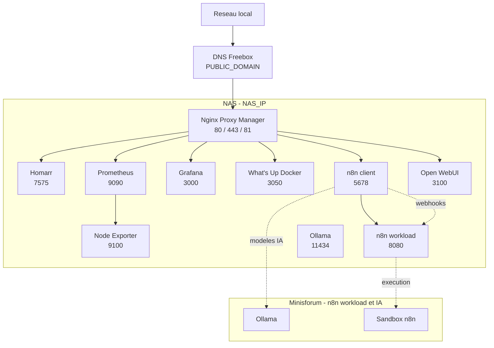

# Homelab Ansible

Déploiement des services Docker du homelab avec Ansible. Les stacks sont
déployées selon le profil Docker et la liste `services_list` de chaque nœud.

## Architecture



## Noeuds

### NAS

Nœud actuellement actif dans l’inventaire :

- Hôte : `nas` (`NAS_IP`)
- Utilisateur Ansible : `homelab`
- Profil Docker : `nas`
- Répertoire des stacks : `/volume1/Docker`

Services disponibles dans `roles/docker_stack/vars/services/` :

- `nginx-proxy-manager` : reverse proxy et gestion des hôtes
- `homarr` : tableau de bord du homelab
- `prometheus` : collecte et stockage des métriques
- `grafana` : visualisation des métriques Prometheus
- `whatsupdocker` : surveillance des images et conteneurs Docker
- `node-exporter` : métriques système du NAS
- `n8n-client` : interface et orchestration n8n
- `n8n-workload` : exécution des workloads n8n
- `open_webui` : interface Web pour les modèles IA
- `ollama` : serveur de modèles IA

Les services effectivement déployés sont contrôlés par `host_vars/nas.yml`.

### Minisforum

Le nœud Minisforum est prévu dans `inventory.yml`, mais reste actuellement
commenté. Il est destiné à héberger les workloads n8n, le sandbox et Ollama
afin de séparer l’exécution et les modèles IA du NAS.

Configuration prévue :

- Hôte : `minisforum`
- Connexion : locale
- Profil Docker : `minisforum`
- Répertoire des stacks : `/opt/homelab`

## Accès réseau

NPM publie les services sur leurs sous-domaines en HTTP sur le réseau local :

| Service | URL |
| --- | --- |
| NPM | `http://npm.PUBLIC_DOMAIN` |
| Homarr | `http://homarr.PUBLIC_DOMAIN` |
| Prometheus | `http://prometheus.PUBLIC_DOMAIN` |
| Grafana | `http://grafana.PUBLIC_DOMAIN` |
| What's Up Docker | `http://wud.PUBLIC_DOMAIN` |

Le domaine est géré par la Freebox. Aucun flux entrant Internet n’étant
ouvert, les certificats Let's Encrypt et le wildcard HTTPS ne sont pas
provisionnés. Les secrets sont conservés dans `group_vars/all/vault.yml`.

## Déploiement

```bash
ansible-playbook -i inventory.yml playbook.yml \
  --vault-password-file .vault_password \
  --ask-become-pass
```

Pour activer un service sur un nœud, ajoutez son nom à `services_list` dans le
fichier `host_vars` correspondant.
