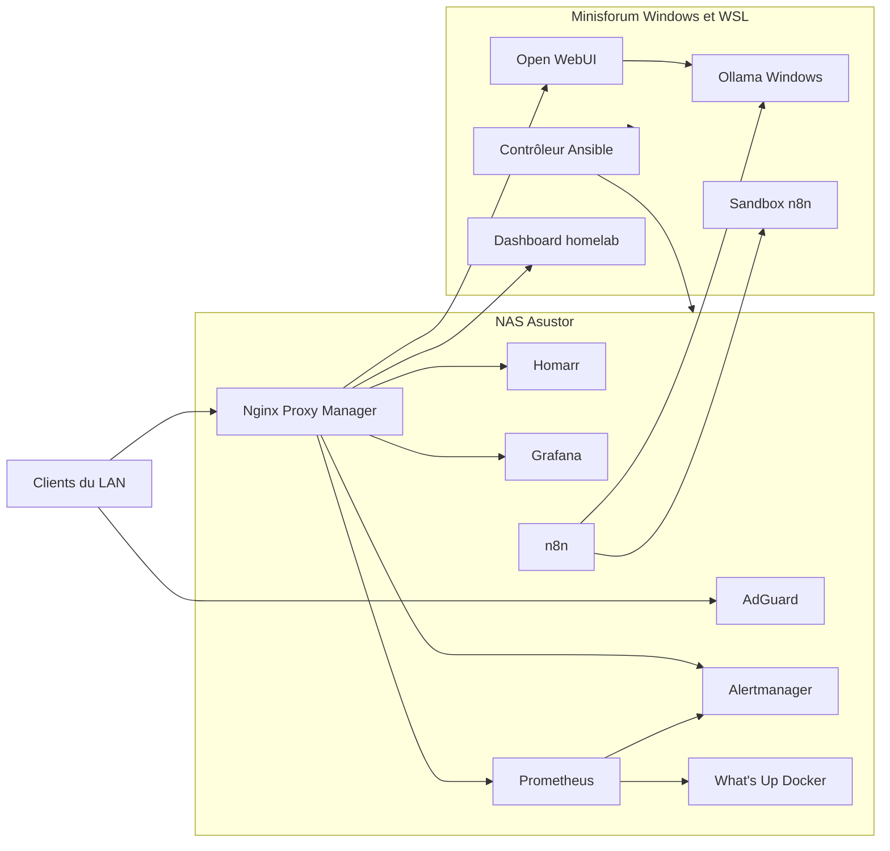

# Homelab Ansible

Déploiement et exploitation d'un homelab réparti sur deux machines :

- un NAS Asustor pour les services permanents ;
- un Minisforum sous Windows/WSL pour les charges locales et l'IA ;
- Ansible comme source de vérité pour la configuration et les déploiements.

Le dépôt est publiable : les adresses, domaines, identifiants et jetons propres à l'installation ne sont pas versionnés. Ils sont chargés depuis Ansible Vault et les fichiers locaux ignorés par Git.

## Architecture



Aucun port entrant n'est volontairement ouvert sur la Freebox. Les services sont destinés au réseau local. Les sorties Internet restent nécessaires pour les images Docker, DNS, SMTP et API externes.

## Services gérés

| Domaine | Services principaux |
| --- | --- |
| Portail et proxy | Homarr, Nginx Proxy Manager |
| Supervision | Prometheus, Grafana, Alertmanager, Node Exporter, cAdvisor |
| Conteneurs | What's Up Docker, automatisation contrôlée des mises à jour |
| Réseau | AdGuard, DNS Windows, certificats TLS locaux |
| IA et automatisation | Ollama, Open WebUI, n8n et sa sandbox |
| Domotique | Home Assistant existant, audité sans réinstallation |
| Sauvegardes | Archives de configuration et manifestes de versions |

AdGuard et Home Assistant sont installés par ADM sur le NAS. Le dépôt les configure ou les audite, mais ne les réinstalle pas. Ollama est un service Windows existant sur le Minisforum.

## Organisation du dépôt

```text
homelab-ansible/
├── ansible.cfg
├── playbook.yml                    # Déploiement global
├── playbook/                       # Opérations et contrôles spécialisés
├── config/                         # Profils de déploiement ciblés
├── roles/docker_stack/
│   ├── defaults/                   # Valeurs publiques non sensibles
│   ├── vars/services/              # Définition des services
│   ├── tasks/                      # Déploiement et post-configuration
│   └── templates/                  # Compose et configurations générées
└── scripts/                        # Collecte, sauvegarde et outils locaux
```

Les éléments suivants restent exclusivement locaux et sont ignorés par Git :

```text
.vault_password
.env
.env.*
inventory.yml
group_vars/
host_vars/
.local-pki/
artifacts/
logs/
```

`.env.example` peut être versionné à condition de ne contenir que des valeurs fictives.

## Prérequis

- Ubuntu ou WSL avec Ansible ;
- accès SSH et sudo au NAS ;
- Docker et Docker Compose sur les hôtes concernés ;
- collections Ansible `community.docker` et `community.crypto` ;
- un inventaire local ;
- un fichier Ansible Vault et son mot de passe local.

```bash
ansible-galaxy collection install community.docker community.crypto
```

## Configuration privée

`ansible.cfg` recherche par défaut l'inventaire dans `./inventory.yml`, les rôles dans `./roles` et le mot de passe Vault dans `./.vault_password`.

Créer le fichier du mot de passe sans le versionner :

```bash
printf '%s\n' 'votre-mot-de-passe-vault' > .vault_password
chmod 600 .vault_password
```

Créer ou modifier le Vault :

```bash
mkdir -p group_vars/all
ansible-vault create group_vars/all/vault.yml
# ou, s'il existe déjà :
ansible-vault edit group_vars/all/vault.yml
```

Variables d'infrastructure attendues dans le Vault :

```yaml
nas_ip: "..."
minisforum_host: "..."
ollama_windows_host: "..."
freebox_ip: "..."
basedomain: "..."
alert_email_to: "..."
```

Le Vault contient également les comptes, mots de passe et jetons nécessaires aux services : NPM, Homarr, SMTP, Home Assistant, Freebox OS, n8n, GitHub et fournisseurs de calendriers.

Vérifier uniquement la présence des paramètres, sans afficher leur valeur :

```bash
ansible-playbook playbook/vault-readiness.yml
```

## Démarrage rapide

Toutes les commandes doivent être lancées depuis la racine du dépôt.

```bash
# Vérifier la syntaxe
ansible-playbook playbook.yml --syntax-check

# Déployer les services définis dans l'inventaire
ansible-playbook playbook.yml

# Déployer un profil précis
ansible-playbook playbook/operations.yml -e @config/monitoring-nas.yml
ansible-playbook playbook/operations.yml -e @config/monitoring-minisforum.yml
```

Autres profils courants :

```bash
ansible-playbook playbook/operations.yml -e @config/alertmanager.yml
ansible-playbook playbook/operations.yml -e @config/grafana.yml
ansible-playbook playbook/operations.yml -e @config/homarr-dashboard.yml
ansible-playbook playbook/operations.yml -e @config/update-automation.yml
```

## Opérations courantes

### Supervision

```bash
ansible-playbook playbook/verify-monitoring.yml
ansible-playbook playbook/verify-homarr-dashboard.yml
ansible-playbook playbook/quota-collectors.yml
```

### DNS et TLS

Auditer avant de modifier :

```bash
ansible-playbook playbook/adguard-audit.yml
ansible-playbook playbook/adguard-configure.yml
ansible-playbook playbook/pki.yml
ansible-playbook playbook/proxy.yml
```

Le DNS Windows est appliqué uniquement sur demande et depuis une session disposant des droits administrateur :

```bash
ansible-playbook playbook/windows-dns.yml
ansible-playbook playbook/windows-dns.yml -e windows_dns_apply=true
```

### Sauvegardes et mises à jour

```bash
ansible-playbook playbook/backup-config.yml
ansible-playbook playbook/verify-update-automation.yml
ansible-playbook playbook/update-alertmanager.yml
ansible-playbook playbook/schedule-container-updates.yml
```

Les sauvegardes et tests d'e-mail ne sont pas idempotents : ils créent volontairement une archive ou un événement supplémentaire.

### Audits applicatifs

```bash
ansible-playbook playbook/audit.yml
ansible-playbook playbook/npm-audit.yml
ansible-playbook playbook/homeassistant-audit.yml
ansible-playbook playbook/homeassistant-auth-check.yml
ansible-playbook playbook/test-alert-email.yml
```

`test-alert-email.yml` envoie réellement une alerte et peut aussi produire un message de résolution.

## Sécurité

- Ne jamais ajouter `.vault_password`, un Vault déchiffré, `.env`, une clé privée ou une archive de sauvegarde à Git.
- Conserver les clés de CA dans `.local-pki/`. Seul le certificat public `ca.crt` doit être distribué aux clients.
- Les templates Compose susceptibles de contenir des secrets sont générés avec des permissions restrictives.
- Les tâches manipulant des identifiants utilisent `no_log` lorsque nécessaire.
- Un montage du socket Docker, même en lecture seule, donne un accès très privilégié au moteur Docker.
- Le runner n8n privilégié doit rester limité au réseau et aux usages prévus.
- L'absence de redirection de ports Internet ne remplace pas l'authentification sur le LAN.

Avant de publier une modification :

```bash
for file in playbook/*.yml; do
  ansible-playbook "$file" --syntax-check || exit 1
done

git diff --check
git status --short
```

Un scanner de secrets tel que Gitleaks est recommandé en local et dans la CI.

## Comportement des déploiements

Le rôle `docker_stack` :

1. charge les variables propres au service ;
2. génère son `.env` et son fichier Compose ;
3. applique les configurations nécessaires ;
4. démarre ou réconcilie la stack ;
5. vérifie son état ;
6. exécute les éventuelles post-configurations et routes proxy.

Les images utilisent `pull: missing` par défaut afin d'éviter une mise à jour implicite à chaque exécution. Les migrations sensibles, notamment Alertmanager, suivent un chemin explicite de validation, sauvegarde, test et promotion.

## Limites connues

- L'inventaire et le Vault doivent être sauvegardés séparément du dépôt.
- Les archives applicatives doivent être copiées hors du NAS.
- Les exporters WSL ne remplacent pas une supervision complète de Windows.
- La confiance dans la CA locale doit être installée sur chaque client utilisant HTTPS.
- Les restaurations complètes et la rotation de tous les secrets doivent être testées régulièrement.

## Licence et contribution

Ce dépôt décrit une infrastructure personnelle. Vérifier les chemins, ports, images et hypothèses de sécurité avant toute réutilisation dans un autre environnement.
